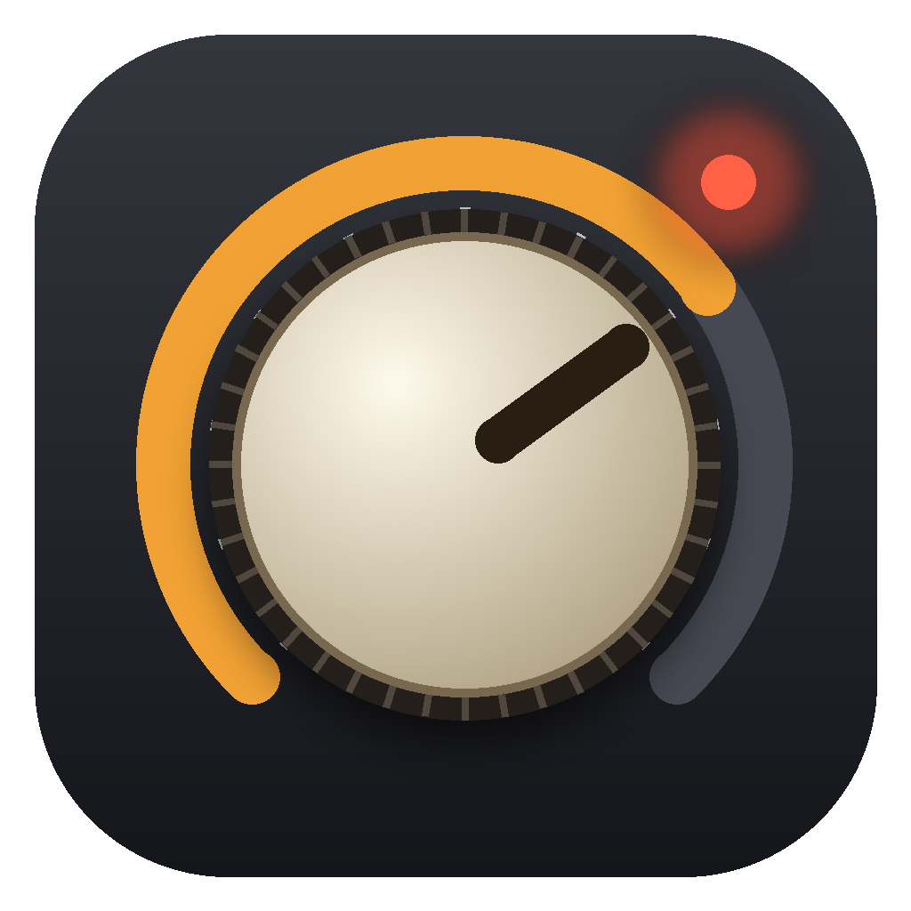
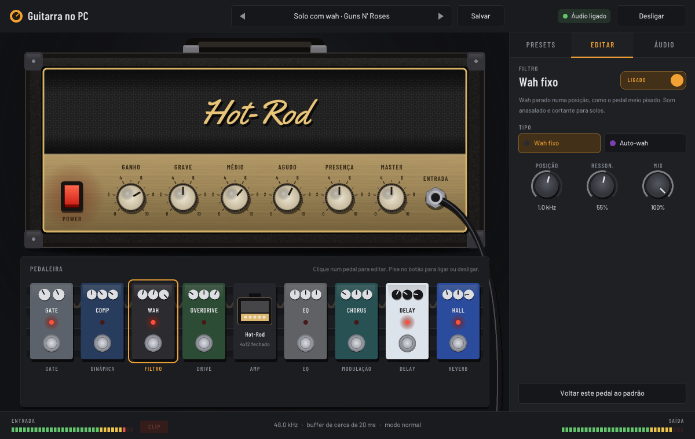
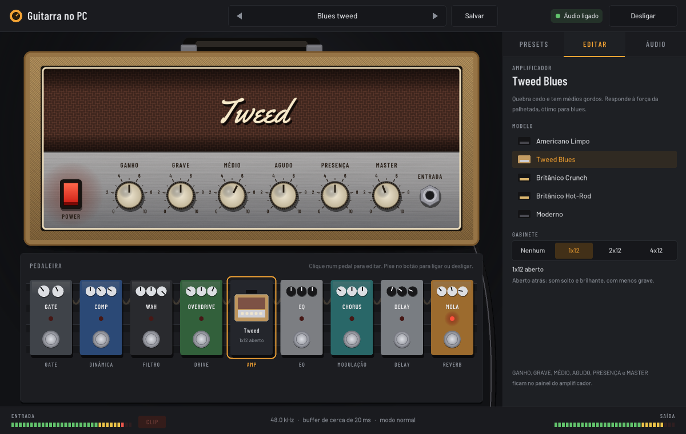

<p align="center">
  
</p>

<h1 align="center">Guitarra no PC</h1>

<p align="center">
  Plugue a guitarra no computador e toque com amplificadores, pedais e gravação.<br>
  Programa para Windows, gratuito, sem instalação.
</p>



## Download

Baixe o `GuitarraNoPC.exe` na página de [**Releases**](../../releases) e abra com dois cliques. Não precisa instalar nada.

- Funciona no **Windows 10 e 11, 64 bits**.
- Na primeira vez, o Windows pode mostrar *"O Windows protegeu o computador"*, porque o programa não tem assinatura digital. Clique em **Mais informações** e depois em **Executar assim mesmo**.
- Se o Windows bloquear o microfone, ative em **Configurações → Privacidade e segurança → Microfone**, incluindo *"Permitir que aplicativos da área de trabalho acessem o microfone"*.

## Como ligar a guitarra

1. Plugue a guitarra numa **interface de áudio USB** (ou num cabo/adaptador USB de guitarra). Funciona também na entrada P2 do PC com um adaptador, mas com mais chiado.
2. Abra o programa e, na aba **Áudio**, escolha a **entrada** (onde está a guitarra) e a **saída** (fone ou caixa).
3. Ajuste o **Nível da entrada** até o medidor de ENTRADA chegar no amarelo quando você toca forte.
4. Use **fone com fio**: o Bluetooth deixa o som atrasado.

## O que ele faz

**5 amplificadores**, cada um com som e visual próprios, e knobs de GANHO, GRAVE, MÉDIO, AGUDO, PRESENÇA e MASTER:

| Amplificador | Som |
|---|---|
| Americano Limpo | Limpo e cristalino, com muita folga |
| Tweed Blues | Quebra cedo, médios gordos, ótimo para blues |
| Britânico Crunch | Crunch de rock clássico |
| Britânico Hot-Rod | Mais ganho e sustentação, hard rock |
| Moderno | Alto ganho com graves firmes |

**Gabinetes** 1x12 aberto, 2x12 e 4x12 fechado, para a distorção soar como caixa de verdade.

**Pedaleira com 8 pedais**, na ordem do sinal: Gate → Compressor → Filtro (wah fixo, auto-wah) → Drive (overdrive, distorção, fuzz, boost) → Amplificador → EQ de 7 bandas → Modulação (chorus, flanger, phaser, tremolo) → Delay (digital, analógico) → Reverb (sala, hall, mola).

**Presets** prontos de funk e limpos no estilo Chili Peppers, blues texano, AC/DC e Guns N' Roses. Você ajusta e salva os seus.

**Gravação** em WAV de 24 bits, com a opção de gravar também a guitarra limpa (sem efeitos) para mudar o timbre depois. Dá para ouvir as gravações e tocar junto por cima.



### Atalhos

| Tecla | Ação |
|---|---|
| Espaço | Liga e desliga o áudio |
| R | Começa e para a gravação |
| Ctrl+S | Salva o preset |
| Arrastar um knob | Para cima ou para baixo muda o valor. Com Shift, ajuste fino |
| Duplo clique num knob | Volta ao valor padrão |

### Onde ficam os arquivos

Ao lado do `.exe` o programa cria `guitarra.ini` (configurações), `presets.txt` (seus presets) e a pasta `Gravações`. Se a pasta do programa não permitir escrita, as gravações vão para `Documentos\Guitarra no PC\Gravações`.

## Compilar a partir do código

O programa é escrito em C. A janela usa [raylib](https://www.raylib.com) e o áudio usa [miniaudio](https://miniaud.io) com WASAPI. A compilação é feita com o [zig](https://ziglang.org), que gera o `.exe` para Windows a partir de qualquer sistema.

**No Windows**, com o zig e o git instalados:

```bat
build.bat
```

**No Linux, macOS ou WSL:**

```sh
./build.sh
# sem o zig instalado:
pip install ziglang
ZIG="python3 -m ziglang" ./build.sh
```

O resultado fica em `build/GuitarraNoPC.exe`. O script baixa a raylib 5.5 na primeira vez.

### Estrutura

| Pasta / arquivo | Conteúdo |
|---|---|
| `src/gui.c` | Janela, amplificador desenhado, pedaleira e abas |
| `src/dsp.c` | Motor de som: amplificadores, gabinetes e todos os efeitos |
| `src/rigio.c` | Presets de fábrica e o formato dos presets salvos |
| `src/audio.c` | Entrada e saída de áudio (WASAPI) |
| `src/recorder.c` | Gravação e reprodução de WAV |
| `tests/presets_test.c` | Passa uma guitarra sintética por todos os presets e efeitos e mede volume e estabilidade |
| `tools/` | Scripts que geram o ícone e embutem fontes e ícone no código |

Para rodar o teste (em qualquer sistema com gcc ou clang):

```sh
gcc -O2 -Isrc tests/presets_test.c src/dsp.c src/rigio.c -lm -o presets_test && ./presets_test
```

## Créditos

- [raylib](https://github.com/raysan5/raylib) — licença zlib
- [miniaudio](https://github.com/mackron/miniaudio) — domínio público ou MIT-0 (`third_party/miniaudio.h`)
- Fontes [Barlow e Barlow Condensed](https://fonts.google.com/specimen/Barlow) — SIL Open Font License (`fonts/OFL-*.txt`)
- Fonte [Yellowtail](https://fonts.google.com/specimen/Yellowtail) — Apache License 2.0 (`fonts/LICENSE-Yellowtail.txt`)

Os nomes de bandas nos presets indicam apenas o estilo de som que cada um busca. O projeto não tem ligação com essas bandas nem com fabricantes de equipamentos.
